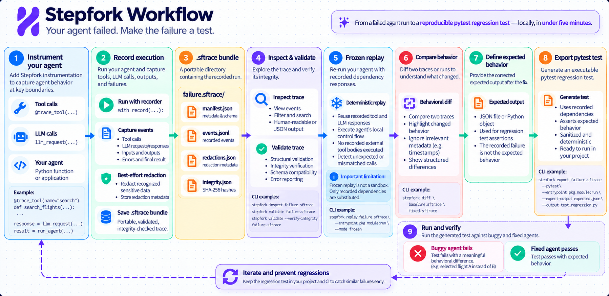

# Stepfork

**Open-source behavioral regression testing for AI agents.**

[PyPI](https://pypi.org/project/stepfork/) ·
[Documentation](https://utsab345.github.io/stepfork/) ·
[CI](https://github.com/utsab345/stepfork/actions/workflows/ci.yml) ·
[Issues](https://github.com/utsab345/stepfork/issues)

## The problem

Unit tests often miss regressions in multi-step agent behavior. A recorded run
can show what the agent called and returned, but replaying against live tools or
models makes a regression test slow, costly, and nondeterministic.

Stepfork captures instrumented dependency calls in a local trace and replays
their recorded responses. You can compare runs and export a pytest test with an
explicit expectation for the corrected behavior.

## How it works

**Instrument → record → frozen replay → compare → export a pytest regression**

Wrap tool and LLM boundaries you want captured. Frozen replay strictly matches
those calls and substitutes recorded responses, so the wrapped bodies are not
run again. Calls outside instrumented boundaries are not intercepted.



## Features

- Record completed and failed runs as local `.sftrace` bundles.
- Inspect and validate traces; check bundle integrity.
- Replay instrumented tool and LLM calls with recorded responses.
- Compare traces and inspect behavior-level differences.
- Save named local baselines and gate trace changes in CI
  ([guide](docs/baselines.md)).
- Export pytest regression tests with output and trajectory expectations.
- Minimize failing traces and fork traces at a selected step.
- Use optional OpenAI Python SDK and LangGraph adapters.
- Best-effort redaction of common credential patterns when recording.

Stepfork is experimental. Redaction is not a guarantee against sensitive-data
leaks, integrity hashes are not signatures, and replay is not a sandbox. See
[security notes](docs/security.md).

## Installation

```bash
pip install stepfork
```

Requires Python 3.11–3.13. Install an adapter only if needed:

```bash
pip install "stepfork[openai]"
pip install "stepfork[langgraph]"
```

## Quick start

Save this as `quickstart.py`. The example records a shipped order that the
buggy agent fails to notify about.

```python
from stepfork import record, trace_tool


@trace_tool
def order_status(order_id: str) -> dict[str, str]:
    return {"order_id": order_id, "status": "shipped"}


def run_agent() -> dict[str, bool]:
    order = order_status("ORD-1001")
    return {"notify": order["status"] == "delivered"}  # Bug: should notify on shipment


if __name__ == "__main__":
    with record("order-agent", output="failure.sftrace") as session:
        result = run_agent()
        session.set_output(result)
    print(result)
```

Run and inspect the captured behavior, then export a test for the expected
behavior:

```bash
python quickstart.py
stepfork inspect failure.sftrace
stepfork replay failure.sftrace --entrypoint quickstart:run_agent
printf '{"notify": true}\n' > expected.json
stepfork export failure.sftrace \
  --entrypoint quickstart:run_agent \
  --expect-output expected.json \
  --output test_order_regression.py
```

Change the condition in `run_agent` to check for `"shipped"`, then run
`python -m pytest -q test_order_regression.py`. Install `pytest` separately if
it is not already available. See the [complete quickstart](docs/getting-started.md)
for the replay and test workflow.

See the [terminal demo](scripts/terminal-demo/stepfork-demo.gif).

## Integrations

The core API is framework-independent. Optional adapters currently support:

- **OpenAI Python SDK:** sync and async, non-streaming
  `chat.completions.create`.
- **LangGraph / LangChain:** sync and async chat-model generation and wrapped
  function tools; streaming is not supported.

An example [GitHub Actions workflow](.github/workflows/agent-regression.yml)
runs committed regression tests without provider credentials. Stepfork does
not currently provide a reusable GitHub Action or an MCP adapter. See the
[integration details](docs/integrations.md).

## Contributing

Contributions are welcome. Read the [contribution guide](CONTRIBUTING.md) and
[development instructions](docs/development.md), then open an issue or pull
request. Please do not include credentials or unreviewed trace data in issues,
tests, or commits.

## License

Apache-2.0. See [LICENSE](LICENSE).
